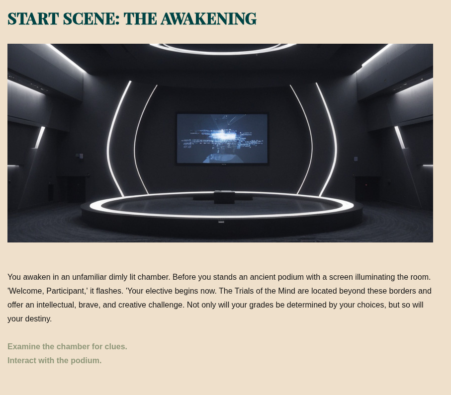

# The Trials of the Mind

**An interactive mystery built with Twine, SugarCube 2, HTML, CSS and JavaScript.**

**Trinity College Dublin · TEU00062 - Engaging in the Digital World: Today and Tomorrow · 2023–2024**

*The Trials of the Mind* is a collaborative branching-narrative game created by six students to explore how **player choice, interactive challenges and audiovisual storytelling** shape engagement. You begin in a mysterious chamber and choose how to navigate a network of trials, discoveries and alternative outcomes.

This repository presents an independently maintained copy of the team's completed project. It preserves the supplied game source and browser build.



## Highlights

- **Branching interactive fiction:** player choices link the Labyrinth, Arena, forest and other trials, with multiple ending passages.
- **Interactive gameplay:** riddles, conditional decisions, inventory-related state and non-deterministic outcomes using SugarCube macros.
- **Atmospheric presentation:** scene illustrations, sound effects, custom CSS and JavaScript-driven interface controls.
- **Original story design:** a structured passage-based narrative with documented alternate paths, puzzles and story outcomes.
- **Preserved source and build:** editable Twine/Twee source alongside the compiled browser version.

The preserved `Home.twee` source defines **98 passages, including metadata and support passages**, and contains **154 wiki-link occurrences**. 

## Play locally

The game is a static site. From the repository root, start a web server:

```bash
python3 -m http.server 8000
```

Open **http://localhost:8000/** to start playing. You can also open `index.html` directly, although a local server is preferable when loading relative media files. Audio playback can depend on browser permissions and user interaction.

> **Display fonts:** The original game references font binaries that are not bundled in this project. The narrative remains usable with browser font fallbacks; for the historical appearance, consult [asset and licensing notes](docs/ASSET-AND-LICENSING.md) before restoring those files from the separately retained original archive.

## Technical implementation

| Area | Implementation |
|---|---|
| Story engine | Twine, **SugarCube 2.36.1** |
| Original editable source | [`Home.twee`](Home.twee) — passages, markup, macros, CSS and JavaScript |
| Browser build | [`index.html`](index.html) — compiled static game |
| Presentation | Custom sidebar, responsive CSS, scene art, fonts and audio |
| Mechanics | Passage links, conditional navigation, non-deterministic branches and limited inventory interactions |
| Assets | [`images/`](images/) and [`music/`](music/) with original relative paths |
| Verification | [`tests/verify_project.py`](tests/verify_project.py) — standard-library static checks |

The report describes use of SugarCube extensions, including Simple Inventory 3 and Chapel's macro collection. Rebuilding the bundled source would require an appropriate Twine/Twee compiler configuration; the included `index.html` is the preserved play-ready build, and no reproducible compiler pipeline is claimed.

## Project structure

```text
.
├── Home.twee                # Original Twine/Twee source
├── index.html               # Compiled game (GitHub Pages entry point)
├── images/                  # 65 original visual assets
├── music/                   # 10 original audio assets
├── fonts/                   # Restoration and rights notes (no font binaries included)
├── docs/
│   ├── screenshots/         # Opening and key-discovery captures
│   ├── CONTRIBUTORS.md      # Roles from the team report
│   ├── TECHNICAL-NOTES.md   # Design, implementation and verification limits
│   ├── ASSET-AND-LICENSING.md
│   ├── PROVENANCE.md
│   └── SHA256SUMS.txt
├── tests/
│   └── verify_project.py
├── .github/workflows/
│   └── verify.yml           # Static checks on pushes and pull requests
├── .gitignore
├── .nojekyll
└── README.md
```

## Team

**Leah Weldon · Anthony Rowe · Aoife Hayes · Holly Kennelly · Yuuv Jauhari · Rishi R. Kataria**

The game was a joint university submission. All six people are credited, with implementation and documentation responsibilities detailed in [CONTRIBUTORS.md](docs/CONTRIBUTORS.md).

## Verification and provenance

See [TECHNICAL-NOTES.md](docs/TECHNICAL-NOTES.md) and [PROVENANCE.md](docs/PROVENANCE.md) for the complete scope and outstanding limitations.

## Rights and attribution

See [ASSET-AND-LICENSING.md](docs/ASSET-AND-LICENSING.md) before publishing, redistributing or adapting third-party assets. If any permissions cannot be verified, resolve them with the relevant rights holders or replace the asset before making the repository public.
